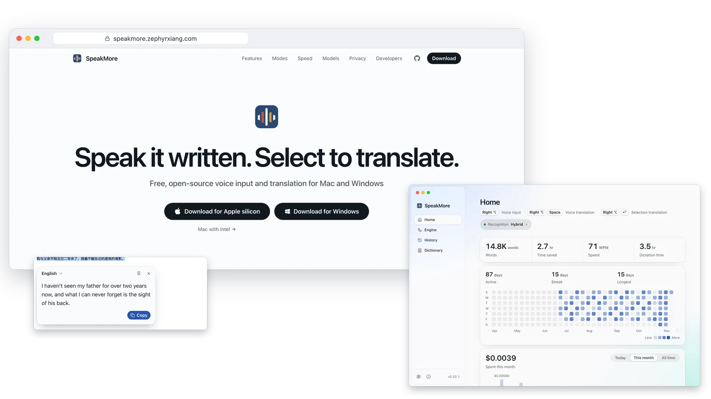
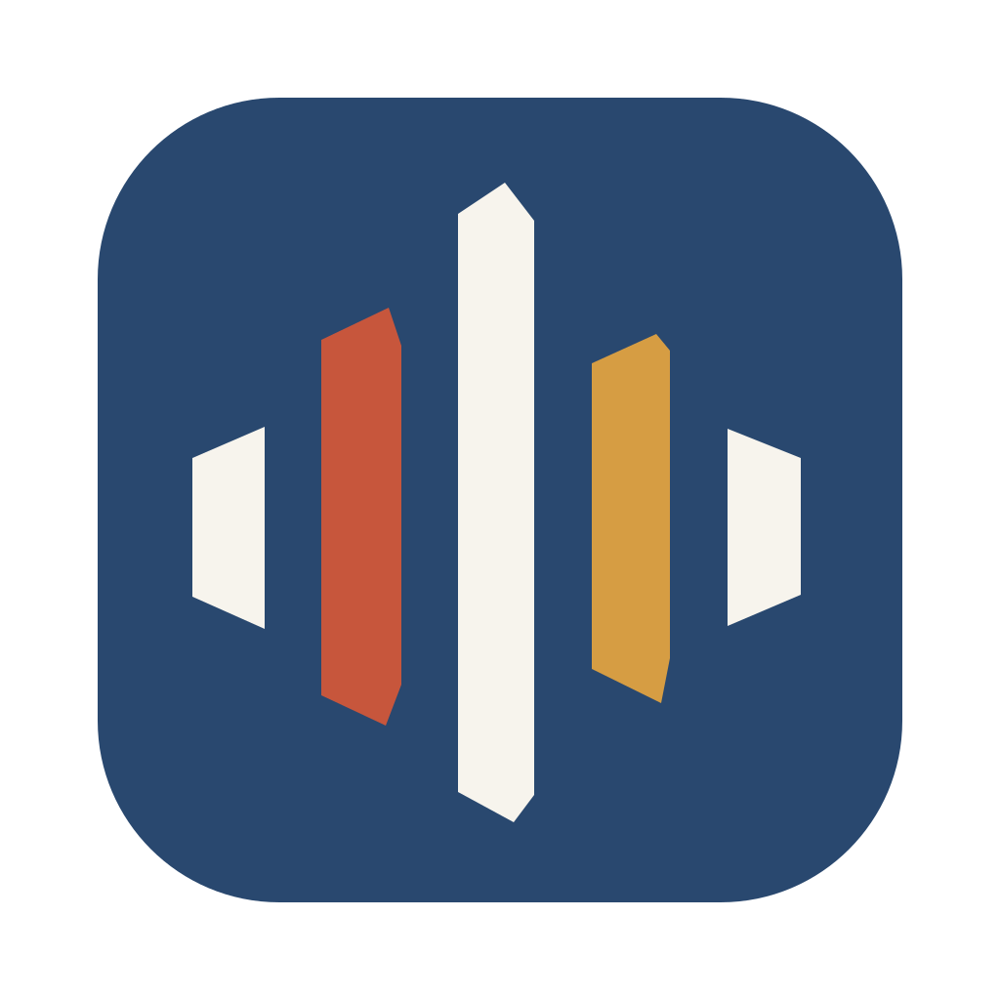
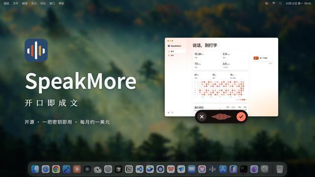
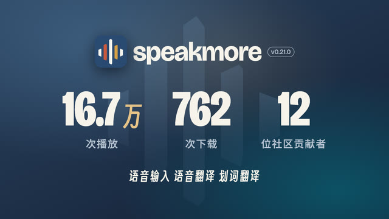
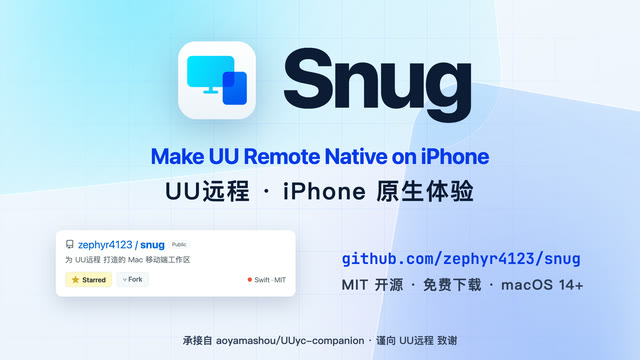
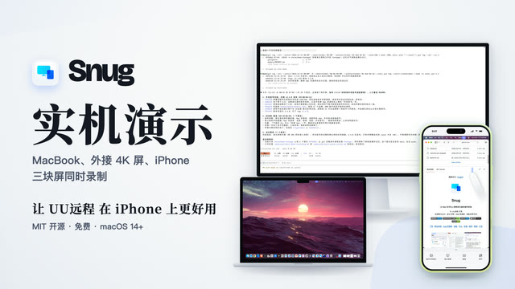
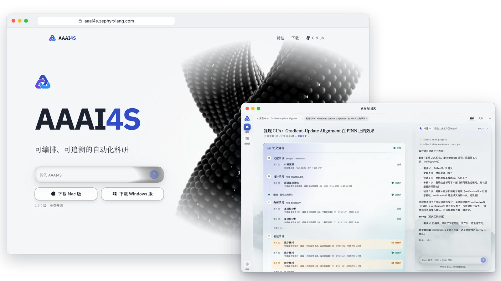
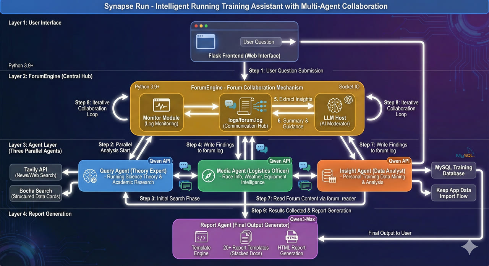

# Hi, I'm zephyr 👋

**Agent memory researcher & builder.** 
**AI-era productivity tools** — built for my own daily use.

<table>
<tr>
<td width="50%" valign="top">

** Now**

-  **Agent memory research** MS student @ Tianjin University
-  **Technical Advisor @ Turing Synergy** Full-stack iOS apps in production
-  **Open-source tools** Voice input & translation · Mac on your phone · agent‑made video · automated research
-  **Power user**  Claude Code ·  Codex
-  **Tianjin, China** · UTC+8

</td>
<td width="50%" valign="top">

** Background**

-  **Tianjin University** MS, AI · direct admission · 2026 – now BS, AI · 2022 – 2026
-  **LLM App Dev Intern @ DeZhiShang Medical** Graph RAG · 100+ DAU support bot · 8-GPU vLLM
-  **Douyin AI Creator Hackathon 2026** National top 10 in track · 1st at Shenzhen station
-  **LLM Badcase Challenge** China Digital Summit · national 3rd · second prize
-  **Provincial First-Class Scholarship**

</td>
</tr>
</table>

>  **Currently** — multi-agent orchestration methodology · end-to-end iOS products

##  Flagship Projects

###  AI Productivity · tools I use daily

<table>
<tr>
<td width="50%" valign="top">

<h3> <a href="https://github.com/zephyr4123/speakmore">SpeakMore</a></h3>

 **[speakmore.zephyrxiang.com](https://speakmore.zephyrxiang.com)**

**Speak it written. Select to translate.** 
Free & open source · Mac & Windows apps

- **Voice input** · fillers & slips removed
- **Voice translation** · 16 languages
- **Selection translation** · any app
- 29 voice models, or fully on-device

</td>
<td width="50%" valign="top">

<h3> <a href="https://github.com/zephyr4123/snug">Snug</a></h3>

 **Launched Nov 2026 · 11 releases in 4 days**

**Your Mac, native on your phone.** 
Mac menu-bar app · built for UU Remote

- Portrait screen · windows fill the phone
- iOS gestures · scroll, select, long-press
- Claude Code / Codex · your own terminal
- Any phone · 800 models, 17 brands

 Continues [UUyc-companion](https://github.com/aoyamashou/UUyc-companion) by AoyamaShou

</td>
</tr>
</table>

<table>
<tr>
<td width="56%" valign="top">

</td>
<td width="44%" valign="top">

<h3> <a href="https://github.com/zephyr4123/kineto">kineto</a></h3>

**Prompt, don't edit.** 
Agent-first video studio · built on Remotion

- Plain words in · real MP4 out
- Claude Code / Codex · one CLI
- Every asset & render on record

 Films: [kineto launch](https://kineto.zephyrxiang.com/renders/kineto-promo/kineto-promo-714bded14437.mp4) · [SpeakMore launch](https://kineto.zephyrxiang.com/renders/speakmore-promo/speakmore-promo-d1ef58b88f15.mp4) · [SpeakMore 0.17](https://kineto.zephyrxiang.com/renders/speakmore-promo-3/speakmore-promo-3-abbea0ee35ef.mp4) · [SpeakMore, one month in](https://kineto.zephyrxiang.com/renders/speakmore-promo-4/speakmore-promo-4-d01b3f70f5d2.mp4) · [Snug launch](https://kineto.zephyrxiang.com/renders/snug-promo/snug-promo-787c68f0e912.mp4) · [Snug live demo](https://kineto.zephyrxiang.com/renders/snug-demo/snug-demo-3cfe9fe1f2ea.mp4)

</td>
</tr>
</table>

###  Multi-Agent Systems · in real use

<table>
<tr>
<td width="50%" valign="top">

<h3> <a href="https://github.com/zephyr4123/TJU-AI4Science">AAAI4S</a></h3>

 **[aaai4s.zephyrxiang.com](https://aaai4s.zephyrxiang.com)**

**Automated research, every number traceable.** 
Mac & Windows apps · Tianjin University

- Seven stages · literature → verification
- Human sign-off at breakpoints only
- Claude Code / Codex as the research assistant

 Repos: [home](https://github.com/zephyr4123/TJU-AI4Science) · [platform](https://github.com/zephyr4123/TJU-AI4Science-Platform) · [site](https://github.com/zephyr4123/aaai4s-site)

</td>
<td width="50%" valign="top">

<h3> <a href="https://github.com/zephyr4123/synapse-run">Synapse Run</a></h3>

**A coaching staff of agents.** 
Multi-agent running coach · Keep / Garmin data

- Specialist agents · forum-style debate
- Training data → personalized plans
- Built by a runner · Forerunner 970 · Whoop 5.0

</td>
</tr>
</table>

##  More Projects

** Agent Memory & Multi-Agent Systems**

- **[memory-ledger](https://github.com/zephyr4123/memory-ledger)** — Provenance-first agent memory on Postgres · append-only typed intents · *as-of* time travel in pure SQL · no embeddings
- **[Emergenta](https://github.com/zephyr4123/Emergenta)** — Civilization simulator · 1000+ agents · emergent revolutions & information cocoons · LLMs for leaders only · ~99% cheaper than full-LLM
- **[sololab](https://github.com/zephyr4123/sololab)** — Self-hostable one-person lab · idea → code → paper · hot-pluggable modules

** Agent Infrastructure & Dev Tools**

- **[blazecoder](https://github.com/zephyr4123/blazecoder)** — Terminal coding agent · parallel sub-agents · native PDF / Word / Excel / PowerPoint editing · DeepSeek · Kimi · OpenAI
- **[llm-eval-from-scratch](https://github.com/zephyr4123/llm-eval-from-scratch)** — Offline-first LLM eval harness · local & API models · MMLU / GSM8K · pluggable scorers
- **[skills-Scaffolding](https://github.com/zephyr4123/skills-Scaffolding)** — Personal Claude Code skill scaffold · one source of truth · plugin marketplace + git symlinks

<b> Learning &nbsp;·&nbsp;  Just for Fun</b>

 

- **[Fact-Guard-Pro](https://github.com/zephyr4123/Fact-Guard-Pro)** — CLI fact-checking agent on LangGraph · human-in-the-loop via Interrupt · Command-based routing
- **[langgraph-quickstart-chineses](https://github.com/zephyr4123/langgraph-quickstart-chineses)** — Gemini deep-research quickstart on Qwen · fully annotated in Chinese
- **[zephyr-notes](https://github.com/zephyr4123/zephyr-notes)** — Personal knowledge base · AI · engineering · current studies
- **[learn-ui](https://github.com/zephyr4123/learn-ui)** — UI course for developers · 9 lessons · UI parts → Apple HIG · real-page critiques
- **[golive-gallery](https://github.com/zephyr4123/golive-gallery)** — Teaching gallery of demo sites · one per deploy tier: free hosting · tunneling · cloud server + HTTPS
- **[above-the-wind](https://github.com/zephyr4123/above-the-wind)** — WebGL2 archive of the fourteen 8000m peaks · golden-age first ascents · real SRTM elevation data
- **[zephyr-picks](https://github.com/zephyr4123/zephyr-picks)** — Tools, fonts & configs I use · Ghostty · Maple Mono · a Claude Code usage mod

##  Tech Stack

##  Writing

Selected posts · [zephyrxiang.com](https://zephyrxiang.com)

<!-- BLOG-POST-LIST:START -->
- **[Notes on How the Claude Code Team Does Code Review](https://zephyrxiang.com/blog/claude-code-team-code-review/)**
- **[Notes on Getting Started with Claude Code Mods](https://zephyrxiang.com/blog/claude-code-mods/)**
- **[Notes on Automating Eval Design and Hillclimbing](https://zephyrxiang.com/blog/automating-eval-hillclimbing/)**
- **[Anatomy of an ngrok Tunnel: How Traffic Reaches Your localhost](https://zephyrxiang.com/blog/ngrok-tunneling-explained/)**
- **[Persisting AI Conversations with Multica: From Throwaway Sessions to Project and Toolkit](https://zephyrxiang.com/blog/persist-ai-sessions-multica/)**<!-- BLOG-POST-LIST:END -->

##  Contact

