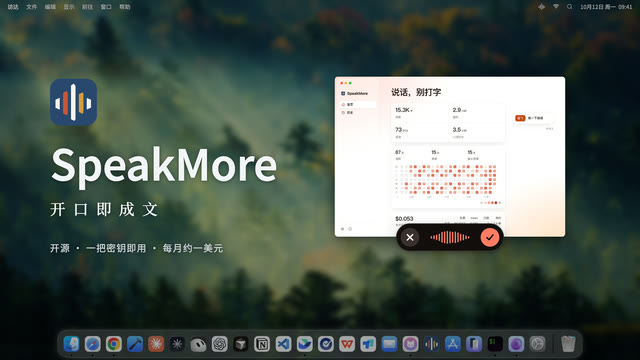
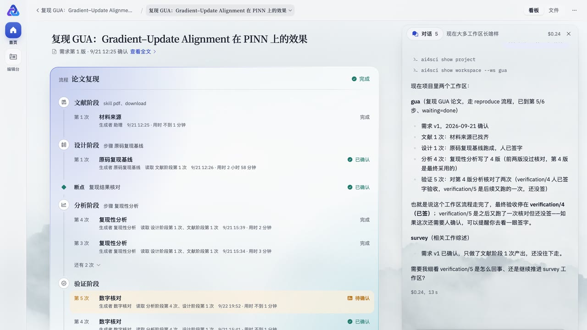
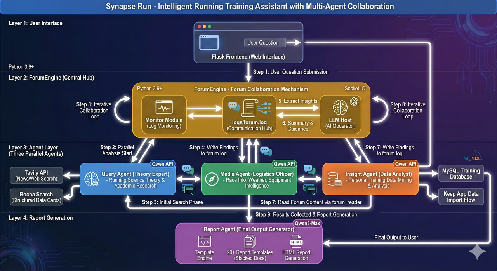

# Hi, I'm zephyr 👋

**Multi-agent systems researcher & builder.** 
**AI-era productivity tools** — built for my own daily use.

-  **Tianjin University** — Artificial Intelligence · direct-admission MS
-  **Research** — Multi-Agent Systems · LLM Orchestration · Social Emergence
-  **Tools** — Voice Dictation · Agent-Made Video · Automated Research
-  **Power User** —  Claude Code ·  Codex
-  **Technical Advisor** @ Turing Synergy — iOS App Development · Multi-Product Builder · Cutting-Edge Collaboration Models
-  **Based in** Tianjin, China · UTC+8

>  **Currently** — multi-agent orchestration methodology · end-to-end iOS products

##  Flagship Projects

###  AI Productivity · tools I use daily

<table>
<tr>
<td width="50%" valign="top">

<a href="https://speakmore.zephyrxiang.com"><picture>
<source media="(prefers-color-scheme: dark)" srcset="https://raw.githubusercontent.com/zephyr4123/zephyr4123/main/assets/speakmore-dark.webp">

</picture></a>

<h3> <a href="https://github.com/zephyr4123/speakmore">SpeakMore</a></h3>

**Speak, don't type.** 
Open-source voice dictation · macOS & Windows

- 29 models, or fully on-device
- Fillers & self-corrections removed
- Free · MIT

</td>
<td width="50%" valign="top">

<h3> <a href="https://github.com/zephyr4123/kineto">kineto</a></h3>

**Prompt, don't edit.** 
Agent-first video studio · built on Remotion

- Plain words in · real MP4 out
- Claude Code / Codex · one CLI
- Every asset & render on record

 Films above: [kineto launch](https://kineto.zephyrxiang.com/renders/kineto-promo/kineto-promo-714bded14437.mp4) · [Life of a Coffee](https://kineto.zephyrxiang.com/renders/coffee-life/coffee-life-4170819b59d6.mp4) · [SpeakMore launch](https://kineto.zephyrxiang.com/renders/speakmore-promo/speakmore-promo-d1ef58b88f15.mp4) · [SpeakMore update](https://kineto.zephyrxiang.com/renders/speakmore-promo-2/speakmore-promo-2-151b9a22c1b0.mp4)

</td>
</tr>
</table>

###  Multi-Agent Systems · in real use

<table>
<tr>
<td width="50%" valign="top">

<h3> <a href="https://github.com/zephyr4123/TJU-AI4Science">AAAI4S</a></h3>

**Automated research, every number traceable.** 
Research automation platform · Tianjin University

- Seven stages · literature → verification
- Human sign-off at breakpoints only
- Claude Code / Codex as the research assistant

 Repos: [home](https://github.com/zephyr4123/TJU-AI4Science) · [platform](https://github.com/zephyr4123/TJU-AI4Science-Platform) · [site](https://github.com/zephyr4123/aaai4s-site)

</td>
<td width="50%" valign="top">

<h3> <a href="https://github.com/zephyr4123/synapse-run">Synapse Run</a></h3>

**A coaching staff of agents.** 
Multi-agent running coach · Keep / Garmin data

- Specialist agents · forum-style debate
- Training data → personalized plans
- Built by a runner · Forerunner 970 · Whoop 5.0

</td>
</tr>
</table>

##  More Projects

** Multi-Agent Systems**

- **[Emergenta](https://github.com/zephyr4123/Emergenta)** — Civilization simulator · 1000+ agents · emergent revolutions & information cocoons · LLMs for leaders only · ~99% cheaper than full-LLM
- **[sololab](https://github.com/zephyr4123/sololab)** — Self-hostable one-person lab · idea → code → paper · hot-pluggable modules

** Agent Infrastructure & Dev Tools**

- **[blazecoder](https://github.com/zephyr4123/blazecoder)** — Terminal coding agent · parallel sub-agents · native PDF / Word / Excel / PowerPoint editing · DeepSeek · Kimi · OpenAI
- **[memory-ledger](https://github.com/zephyr4123/memory-ledger)** — Provenance-first agent memory on Postgres · append-only typed intents · *as-of* time travel in pure SQL · no embeddings
- **[llm-eval-from-scratch](https://github.com/zephyr4123/llm-eval-from-scratch)** — Offline-first LLM eval harness · local & API models · MMLU / GSM8K · pluggable scorers
- **[skills-Scaffolding](https://github.com/zephyr4123/skills-Scaffolding)** — Personal Claude Code skill scaffold · one source of truth · plugin marketplace + git symlinks

<b> Learning &nbsp;·&nbsp;  Just for Fun</b>

 

- **[Fact-Guard-Pro](https://github.com/zephyr4123/Fact-Guard-Pro)** — CLI fact-checking agent on LangGraph · human-in-the-loop via Interrupt · Command-based routing
- **[langgraph-quickstart-chineses](https://github.com/zephyr4123/langgraph-quickstart-chineses)** — Gemini deep-research quickstart on Qwen · fully annotated in Chinese
- **[zephyr-notes](https://github.com/zephyr4123/zephyr-notes)** — Personal knowledge base · AI · engineering · current studies
- **[golive-gallery](https://github.com/zephyr4123/golive-gallery)** — Teaching gallery of demo sites · one per deploy tier: free hosting · tunneling · cloud server + HTTPS
- **[above-the-wind](https://github.com/zephyr4123/above-the-wind)** — WebGL2 archive of the fourteen 8000m peaks · golden-age first ascents · real SRTM elevation data

##  Tech Stack

##  Writing

Selected posts · [zephyrxiang.com](https://zephyrxiang.com)

<!-- BLOG-POST-LIST:START -->
- **[Anatomy of an ngrok Tunnel: How Traffic Reaches Your localhost](https://zephyrxiang.com/blog/ngrok-tunneling-explained/)**
- **[Persisting AI Conversations with Multica: From Throwaway Sessions to Project and Toolkit](https://zephyrxiang.com/blog/persist-ai-sessions-multica/)**
- **[gh: Fitting All of GitHub into Your Terminal](https://zephyrxiang.com/blog/github-cli-gh/)**
- **[The Piolets d'Or: Four Stories on Why How You Climb Matters More Than What You Climb](https://zephyrxiang.com/blog/piolets-dor-four-stories/)**
- **[Cache-Database Consistency: From Cache Aside to Bloom Filters](https://zephyrxiang.com/blog/cache-database-consistency/)**<!-- BLOG-POST-LIST:END -->

##  Contact

